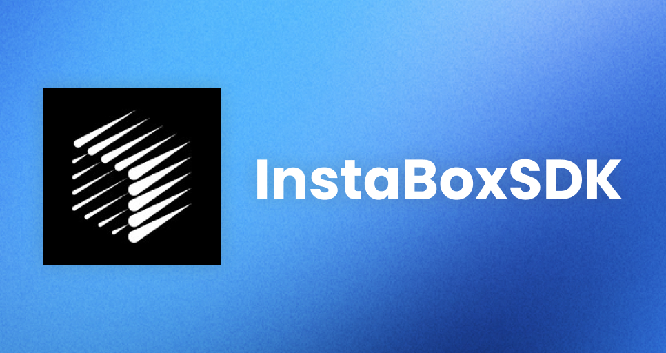

<div align="center">



**Python SDK for [InstaBox](https://instabox.sh) — cloud machines for agents.**

[](https://pypi.org/project/instabox/)
[](https://pypi.org/project/instabox/)
[](LICENSE)

</div>

- Sync (`Client`) and async (`AsyncClient`) clients on `httpx`
- Typed models for machines, operations, snapshots, ports, templates and usage
- Structured error hierarchy mirroring the [API error codes](https://instabox.sh/docs/errors)
- Automatic `Idempotency-Key` (create/start/stop/suspend/resume/fork/delete) and `X-Confirm-Delete` headers
- Long-polling `operations.wait()` — no sleep loops
- Machine pagination via `iter_machines()`
- Streaming command output (`exec_stream`, SSE) and SSH tokens/certificates
- Org & machine secrets, orgs, usage
- SDK-level tool policy (`ToolPolicy`) and an optional local MCP server (`instabox[mcp]`)

## Install

```bash
uv add instabox           # from PyPI, once published
# or from a checkout:
uv sync
```

## Quick start

```python
from instabox import Client

client = Client(api_key="ibk_...")  # or os.environ["INSTABOX_API_KEY"]

# Create and wait for a machine
op = client.machines.create(name="dev", template_id="agent-browser")
op = client.operations.wait(op.id)  # long-polls, no sleeping

# Run a command
result = client.machines.exec("dev", cmd="echo hello")  # get by name or id
print(result.stdout)  # hello

# Files
client.machines.upload_file("dev", "/data/home/notes.txt", b"hi")
data = client.machines.download_file("dev", "/data/home/notes.txt")
listing = client.machines.read_file("dev", "/data/home")

# Lifecycle
client.machines.suspend("dev")  # pause (memory preserved)
client.machines.resume("dev")
op = client.machines.delete("dev")  # X-Confirm-Delete sent automatically
client.operations.wait(op.id)

# Snapshots, ports, account
snap = client.machines.snapshot("dev", "dev-base")
port = client.machines.publish_port("dev", 3000, name="Web app")
print(port.url)
usage = client.account.usage()
```

### Async

```python
from instabox import AsyncClient

async with AsyncClient(api_key="ibk_...") as client:
    op = await client.machines.create(name="dev")
    await client.operations.wait(op.id)
    result = await client.machines.exec(op.machine_id, cmd="uname -a")
    async for machine in client.machines.iter_machines(metadata="task:review"):
        print(machine.id, machine.state)
```

## Machine handles (for agents / models)

Get a stateful handle once and call machine methods directly — mirrors the
TS SDK's `Sandbox` object:

```python
machine = client.machine("dev")        # by name or id; async: client.machine(...)
machine.connect()                      # resume/start if needed, wait until running
result = machine.exec("echo hello")    # does not raise on non-zero exit
machine.run("pytest -q")               # raises RuntimeError on non-zero exit
for kind, chunk in machine.exec_stream("npm test"):
    print(chunk, end="") if kind == "stdout" else None

machine.write_file("/data/home/note.txt", b"hi")
machine.download_file("/data/home/note.txt")
machine.publish_port(3000)
machine.set_metadata({"task": "review"})
machine.wait_operation(machine.start())   # wait for a lifecycle operation
machine.stop()
machine.delete()
```

Available methods: `refresh`, `id`, `is_running`, `wait_until_ready`,
`connect`, `start`, `stop`, `suspend`, `resume`, `restart`, `delete`,
`wait_operation`, `exec`, `run`, `exec_stream`, `read_file`, `write_file`,
`download_file`, `publish_port`, `snapshot`, `ssh_token`, `ssh_certificate`,
`set_metadata`, `update`.

Handles delegate to the client's wrapped resources, so a client-level
`ToolPolicy` (see below) applies to every handle method.

## Streaming output

```python
for kind, payload in client.machines.exec_stream("dev", cmd="npm test"):
    if kind in ("stdout", "stderr"):
        print(payload, end="")
    elif kind == "exit":
        print("exit code:", payload["exitCode"])
```

`AsyncClient` mirrors this with `await`-free `async for` via `exec_stream`.

## SSH, secrets, orgs

```python
token = client.machines.ssh_tokens.create("dev", name="ci")  # token.token — secret, shown once
print(token.command)  # ready-to-run ssh string
client.machines.ssh_tokens.revoke_all("dev")

client.machines.secrets.update("dev", secrets=["DB_PASS"])  # inject org secrets
client.org_secrets.put("org_id", "DB_PASS", "hunter2", delivery="proxy", hosts=["*"])
orgs = client.account.orgs()
```

## Restricting what a client may do

Two layers:

**1. API key scopes (server-side, authoritative).** Keys carry scopes —
`machines:read`, `machines:write`, `machines:delete`, `images:read/write/delete`,
`workspace:admin` (write includes read). Create a scoped key in the dashboard or
`instabox keys create --scope machines:read,images:read`; calls outside the
scopes fail with `403 missing_scope`. To stop an agent from creating or
deleting machines, give it a key **without** `machines:write`/`machines:delete`.

**2. SDK tool policy (client-side).** Allow/deny `resource.method` operation
names — checked before any request is made:

```python
from instabox import Client, ToolPolicy

client = Client(
    api_key=key,
    policy=ToolPolicy(
        allow=[
            "machines.exec",
            "machines.read_file",
            "machines.write_file",
            "machines.get",
            "machines.list",
            "operations.*",
        ],
        deny=["machines.delete"],  # deny always wins
    ),
)
client.machines.exec("dev", cmd="ls")  # ok
client.machines.delete("dev")  # PermissionDeniedError (sdk_not_allowed)
```

## MCP server for AI models

InstaBox ships a hosted MCP server at `https://api.instabox.sh/mcp`
(`instabox mcp init <client>`), but it has **no per-tool toggles** — access is
governed only by API key scopes. This SDK adds a local stdio MCP server with a
per-tool allowlist on top:

```bash
uv add "instabox[mcp]"
export INSTABOX_API_KEY=ibk_...
# default: safe tools only (exec, files, read) — create/delete/snapshot are OFF
export INSTABOX_ALLOWED_TOOLS="exec,read_file,write_file,list_machines,get_machine"
instabox-mcp
```

Register with a client, e.g. Claude Code:

```bash
claude mcp add instabox -- uvx --from "instabox[mcp]" instabox-mcp
```

## Errors

Every API error raises an `APIError` subclass; the machine-readable `code`
and the server's `retryable` flag are always available:

```python
from instabox import exceptions, Client

client = Client(api_key="ibk_...")
try:
    client.machines.exec("dev", cmd="true")
except exceptions.RateLimitError as e:
    if e.retryable and e.retry_after_seconds:
        time.sleep(e.retry_after_seconds)
except exceptions.ConflictError as e:
    ...
```

Status → exception: 400 `BadRequestError`, 401 `AuthenticationError`,
402 `PaymentRequiredError`, 403 `PermissionDeniedError`, 404 `NotFoundError`,
409 `ConflictError`, 429 `RateLimitError`, 5xx `ServerError`.

## Development

```bash
uv sync          # install deps (dev group included)
uv run pytest    # run tests
uv run ruff check . && uv run ruff format --check .
uv run mypy      # strict type checking
```

## Reference

- API docs: https://instabox.sh/docs/api
- Errors: https://instabox.sh/docs/errors
